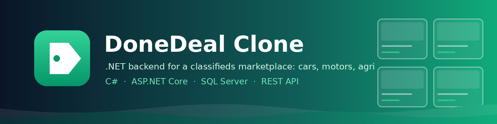

<!-- ═══════════════ HEADER ═══════════════ -->


<div align="center">


<br/>

**DoneDeal Clone: a .NET backend that rebuilds the core of [DoneDeal.ie](https://www.donedeal.ie/), Ireland's classifieds marketplace: listings, advanced search, dealers and selling tools.**

[Overview](#-overview) · [Modules](#%EF%B8%8F-backend-modules) · [Search](#-search--filters) · [Flows](#-main-flows) · [Tech](#-tech-stack) · [Contact](#-contact)

</div>

---

## 🛒 Overview

**DoneDeal Clone** is the **backend API** for a buy-and-sell classifieds platform that recreates **DoneDeal.ie**, Ireland's well-known marketplace for **cars, motors, farming and machinery**.

The backend serves the website and mobile apps. It covers **ads with photos**, a **powerful search with many filters**, **private sellers and dealers with showrooms**, **featured and recent ads**, **price drops**, **monthly finance estimates**, and selling tools such as **"sell to a dealer"** and **car valuation**.

<table>
<tr>
<td align="center" width="25%">📋<br/><b>Listings</b><br/><sub>Ads with photos and full details</sub></td>
<td align="center" width="25%">🔎<br/><b>Search</b><br/><sub>Many filters, sorting, popular searches</sub></td>
<td align="center" width="25%">🏢<br/><b>Dealers</b><br/><sub>Showrooms, trusted dealers, featured stock</sub></td>
<td align="center" width="25%">💶<br/><b>Selling tools</b><br/><sub>Place ad, valuation, sell to a dealer</sub></td>
</tr>
</table>

---

## ⚙️ Backend modules

<table>
<tr>
<td width="50%" valign="top">

### 📋 Listings (ads)
- Create, edit and publish ads (**Place Ad**)
- Multiple **photos** per ad
- Vehicle details: make, model, year, fuel, colour, mileage, price
- **Recent ads** and **featured ads**
- **Price drops**: keeps the original price and shows the reduction

</td>
<td width="50%" valign="top">

### 🗂️ Categories
- **Cars & Motor**: cars, new and vintage cars, commercials, motorbikes, campers, trucks, caravans, trailers, boats, parts
- **Agri & Plant**: farming and plant machinery
- **Lifestyle collections**: Electric, Family, First Car, Luxury, City cars, each with live counts

</td>
</tr>
<tr>
<td width="50%" valign="top">

### 🏢 Dealers
- **Dealer directory** (Find a Dealer)
- Dealer **showrooms** with stock counts
- **Trusted dealer** flag for certified cars
- Featured dealer showcases on the home page

</td>
<td width="50%" valign="top">

### 💶 Selling & pricing tools
- **Monthly finance estimate** shown on listings (e.g. € per month)
- **Car valuation** from registration number and mileage
- **Vehicle history check** integration
- **Sell my car to a dealer**: instant-offer request

</td>
</tr>
<tr>
<td width="50%" valign="top">

### 👤 Accounts
- Sign up and sign in
- Seller profiles: private sellers and dealers
- Each user's own ads

</td>
<td width="50%" valign="top">

### 🛡️ Platform
- Help centre and contact form
- Data request and consent handling
- One API used by the **website and mobile apps**

</td>
</tr>
</table>

---

## 🔎 Search & filters

The search API is the heart of the platform: tens of thousands of cars, filtered in real time.

| Filter group | Examples |
|---|---|
| **Vehicle** | Make, model, year from/to, fuel type, body type, colour, seats, engine size |
| **Price** | Price from/to, road tax |
| **Usage** | Mileage |
| **Location** | County |
| **Seller** | Private or dealer, trusted dealer |
| **Sorting** | Most recent, price and more |
| **Shortcuts** | Popular searches (by make, county, fuel, colour, body type), *your last search* |

---

## 🔄 Main flows

```
 Seller                              Marketplace .NET API                        Buyer
 ──────                              ────────────────────                        ─────
 1. Place ad (+ photos)  ─────────▶  validate, store, index for search
                                     publish → "Recent ads"
                                                         ◀─────────────  2. Search with filters
                                     filtered, sorted results  ─────────▶  3. Browse listings
 4. Drop the price       ─────────▶  keep old price, flag price drop  ──▶  5. Sees the reduction
                                     finance estimate (€ p/m)  ─────────▶  6. Compares cost
 7. Value my car / sell to dealer ─▶  valuation & instant-offer request
```

---

## 🧰 Tech stack

| Part | Technology |
|---|---|
| Language | **C#** |
| Framework | **ASP.NET Core Web API** |
| Database | **SQL Server** |
| API style | REST / JSON for the website and mobile apps |

---

## 📌 Note

This is a **portfolio clone project**. It recreates the features of DoneDeal.ie and isn't affiliated with or endorsed by DoneDeal. *DoneDeal* is a trademark of its owner.

---

## 📬 Contact

<div align="center">

<a href="https://www.linkedin.com/in/ahmed-toba-7378b0206/"></a>
<a href="mailto:ahmedtobashahban21@gmail.com"></a>

<br/><br/>

<sub>Backend by <a href="https://github.com/ahmedtobashahban21">Ahmed Toba Shaban</a></sub>

</div>


